# Temper ZMK Config

My personal [ZMK](https://zmk.dev/) firmware config for the [Temper](https://github.com/raeedcho/temper) — a 36-key wireless split keyboard (3×5 + 3 thumb keys per half).

## Hardware

- 2× [nice!nano v2](https://nicekeyboards.com/nice-nano/) controllers (wireless BLE split)
- SSD1306 128×32 OLED on each half
- Left half is the split **central**

## Firmware

- ZMK pinned to **v0.3.0** (see [`config/west.yml`](config/west.yml) and [`.github/workflows/build.yml`](.github/workflows/build.yml))
- Swedish locale via [joelspadin/zmk-locales](https://github.com/joelspadin/zmk-locales) (`SV_*` keycodes)
- Built automatically by GitHub Actions on every push

## Layout

Swedish QWERTY base, tuned for programming and text editing.

### Layers

| # | Layer | Access |
|---|-------|--------|
| 0 | Default (QWERTY) | — |
| 1 | Win | toggled from Fun |
| 2 | Num | hold right thumb |
| 3 | Nav | hold right thumb |
| 4 | Win Nav | Win + Nav (conditional) |
| 5 | Sym | hold left thumb |
| 6 | Win Sym | Win + Sym (conditional) |
| 7 | Fun | Nav + Sym held together (conditional) |
| 8 | Win Fun | Win + Fun (conditional) |

### Mac / Windows mode

The keymap targets **macOS with the Swedish layout** by default. The `Win` key on the Fun layer toggles Windows mode, which overlays only the keys that differ:

| | Mac (default) | Windows |
|---|---|---|
| Left thumb | ⌘ Cmd | Ctrl |
| Undo / cut / copy / paste / redo | ⌘Z ⌘X ⌘C ⌘V ⌘⇧Z | Ctrl+Z/X/C/V/Y |
| Line start / end | ⌘← / ⌘→ | Home / End |
| Toggle line comment (VS Code) | ⌘⇧7 | Ctrl+' |
| `{` `}` `\|` `\` | ⇧⌥8, ⇧⌥9, ⌥7, ⇧⌥7 | AltGr+7, 0, <, + |
| `< >` | HID 0x35 (macOS swaps it with §) | HID 0x64 |
| Screenshot (area) | ⌘⌃⇧4 → clipboard | Print Screen |

ZMK does not persist the toggle, so the board always starts in Mac mode after a reset or deep sleep. Combos are enabled on both the Default and Win layers.

### Combos (default layer)

| Keys | Output |
|------|--------|
| U + I | å |
| J + K | ä |
| M + , | ö |
| D + F | Backspace |
| C + V | Enter |

### Highlights

- **Mod-morphs** on the base layer: `,`/`;`, `.`/`:`, `?`/`!`, `-`/`_`, and a smart shift that turns into Caps Word.
- **Nav layer** built for editing: sticky mods (Shift / Ctrl / Alt / Gui) on the left home row combine with the arrows, Home/End and Page Up/Down on the right, plus a one-tap clipboard cluster (undo / cut / copy / paste / redo) on the `Z X C V B` positions.
- **Num layer**: one-handed right-hand numpad with decimal point, comma and minus in the inner column.
- **Sym layer**: brackets, braces and parentheses stacked vertically on the left hand.

## Battery

Both halves report their battery level over BLE — the central (left) half proxies the peripheral's level via `CONFIG_ZMK_SPLIT_BLE_CENTRAL_BATTERY_LEVEL_PROXY` and `CONFIG_ZMK_SPLIT_BLE_CENTRAL_BATTERY_LEVEL_FETCHING`. Windows and macOS only show a single level in their own UI, so use an app such as [zmk-battery-center](https://github.com/kot149/zmk-battery-center) to see both halves.

## Building & flashing

Push to `main` → GitHub Actions builds the firmware → download the artifacts from the run and flash each half.
